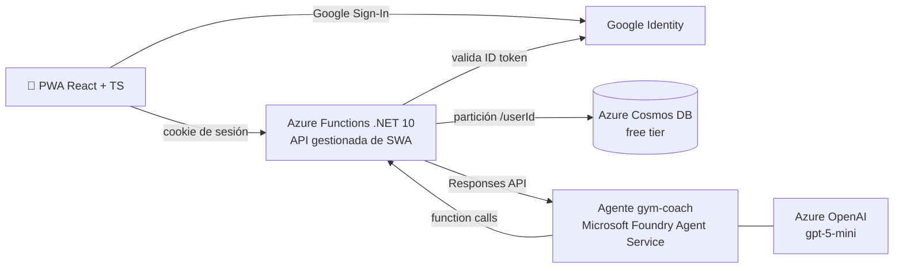

# gym-coach 🏋️

**App de gimnasio (PWA) con un coach de IA que te recomienda con *tus* números, no con consejos genéricos.**

> "Subiste 7.5 kg en banca en 6 semanas, pero tu volumen de espalda bajó." — en vez de "recuerda entrenar espalda".

Registras tus series desde el celular, con una mano y entre series. El coach es un agente de **Microsoft Foundry** que consulta tu historial real con herramientas (function calling) y conversa contigo. Todo corre en Azure con capas gratuitas o de pago por uso: cuesta centavos al mes.

## ✨ Qué hace

- **Registrar entrenos rápido**: series en 1–3 toques, temporizador de descanso, tipos de serie (calentamiento, fallo, drop), rutinas y funciona sin conexión (reenvía al volver la red).
- **Progreso y récords**: récords por ejercicio (peso máximo, e1RM con Epley, repeticiones), gráficos de volumen y mapa muscular.
- **Coach de IA con datos reales**: el agente llama a herramientas como `ver_entrenos_recientes`, `progreso`, `volumen_por_grupo` o `proponer_rutina`. **No inventa números**: todo dato que dice sale de una herramienta.
- **Plan del día**: cada mañana, "Tu entreno de hoy" según tus hábitos, tu equipo y tu tiempo disponible.
- **Memoria de conversación**: una conversación de Foundry por usuario y por día.
- **Importar desde Hevy** (CSV) para no empezar de cero.
- **Español / inglés**, kg / lb.

## 🧱 Arquitectura



- El navegador **nunca** habla con Foundry: la API hace de puente y ejecuta las herramientas con el `userId` del token. El modelo nunca ve ni elige el usuario.
- Si el agente falla en un turno, responde un bucle de function calling propio (respaldo) y, si también falla, la PWA muestra un mensaje amable.

## 🛠️ Tecnologías

| Capa | Tecnologías |
|---|---|
| **Frontend** | React 19, TypeScript 6, Vite 8, PWA (`vite-plugin-pwa`, service worker, modo offline), Chart.js, react-body-highlighter |
| **Backend** | Azure Functions (.NET 10, worker *isolated*), C#, API gestionada de Azure Static Web Apps |
| **Datos** | Azure Cosmos DB for NoSQL (free tier, partición `/userId`, control de concurrencia con ETag) |
| **IA** | Microsoft Foundry: Agent Service + Azure OpenAI (`gpt-5-mini`), function calling, SDK `OpenAI` para .NET |
| **Auth y seguridad** | Google Sign-In (OIDC, validación del ID token en el backend), cookie de sesión firmada (HMAC), CSP y headers de seguridad, límites por usuario (429 + `Retry-After`), validación en el servidor |
| **Calidad** | xUnit v3 (unitarias + integración contra el emulador de Cosmos), Vitest, oxlint, 23 casos de evaluación del coach |
| **Infra y DevOps** | Azure Static Web Apps (Free), GitHub Actions (CI/CD), Azure CLI, Azure Identity, SWA CLI, Azure Functions Core Tools |
| **Desarrollo con IA** | Claude Code con agentes propios (planner → coder → qa → adversary) |

## 🗺️ Roadmap

| Etapa | Estado |
|---|---|
| 1. Registrar entrenos (sin IA) | ✅ |
| 2. Coach con modelo mini + function calling | ✅ |
| 3. Coach como agente en Foundry Agent Service | 🚧 actual |
| 4. Herramientas como servidor MCP (también desde Claude Desktop) | ⏳ |
| 5. RAG con Foundry IQ / Azure AI Search (guías y notas) | ⏳ |
| 6. Seguridad y gobierno completos | ⏳ |
| 7. Evaluación del coach | ⏳ |

Detalle, costos y criterio de "listo" de cada etapa: [`docs/roadmap.md`](docs/roadmap.md). Lecciones aprendidas: [`docs/playbook.md`](docs/playbook.md).

## 💸 Barato primero

| Recurso | Capa | Costo |
|---|---|---|
| Azure Static Web Apps + Functions | Free | 0 USD |
| Azure Cosmos DB | Free tier (400 RU/s) | 0 USD |
| Azure OpenAI (`gpt-5-mini`) | Pago por token | Centavos / mes |

---

## 🧑‍💻 Guía de desarrollo

### Estructura

| Carpeta | Qué hay |
|---|---|
| `app/` | PWA (Vite + React). `staticwebapp.config.json` va aquí. |
| `api/` | Functions C#: `Auth/ValidadorGoogle.cs`, `Catalogo.cs`, `Validacion.cs`, `Functions/`. |
| `api.Tests/` | xUnit: unitarias + integración contra el emulador de Cosmos (se saltan si no hay emulador). |
| `herramientas/` | `init-cosmos.cs` (crea DB y contenedor) e `iconos.mjs` (regenera los PNG de la PWA). |

## Correr en local

### Requisitos

- .NET SDK 10 y Node 24 / npm 11.
- [Emulador de Azure Cosmos DB para Windows](https://learn.microsoft.com/azure/cosmos-db/emulator) (instalador nativo). Escucha en `https://localhost:8081` y usa la clave pública documentada del emulador.
- Functions Core Tools y SWA CLI **no** hace falta instalarlos: vienen como devDependencies del `package.json` raíz.

### 1. Client ID de Google (una vez)

1. [Google Cloud Console](https://console.cloud.google.com/) → crea (o elige) un proyecto.
2. *APIs y servicios → Pantalla de consentimiento de OAuth*: tipo **Externo**, nombre de la app, tu correo. Los scopes por defecto (`openid`, `email`, `profile`) bastan.
3. *Credenciales → Crear credenciales → ID de cliente de OAuth → Aplicación web*.
4. **Orígenes de JavaScript autorizados**: `http://localhost:4280` y `http://localhost:5173` (en producción, agregar la URL de la Static Web App). No hacen falta URIs de redirección.
5. Copia el Client ID (`xxxx.apps.googleusercontent.com`). No es un secreto, pero va en archivos ignorados por git igual que el resto de la configuración.

### 2. Configuración local

```sh
npm install                 # raíz: Core Tools, SWA CLI
npm --prefix app install    # PWA
cp api/local.settings.example.json api/local.settings.json   # poner GOOGLE_CLIENT_ID
cp app/.env.example app/.env.local                           # poner VITE_GOOGLE_CLIENT_ID (el mismo)
```

`api/local.settings.json` y `app/.env.local` están en `.gitignore`.

`SESSION_SECRET` firma la cookie de sesión y es obligatorio: sin él la API no arranca. Genera uno propio (base64 de 48 bytes al azar) y pégalo en `api/local.settings.json`; no lo compartas ni lo reutilices en Azure:

```powershell
# Windows PowerShell 5.1
$b = New-Object byte[] 48; [Security.Cryptography.RandomNumberGenerator]::Create().GetBytes($b); [Convert]::ToBase64String($b)
# pwsh 7
[Convert]::ToBase64String([Security.Cryptography.RandomNumberGenerator]::GetBytes(48))
```

Si el navegador descarta la cookie en `http://localhost` (exige `Secure`), agrega `"SESSION_COOKIE_INSECURE": "1"`: solo tiene efecto con Core Tools (`AZURE_FUNCTIONS_ENVIRONMENT=Development`) y la cookie pasa a llamarse `gc_sesion`. Detalle en [`docs/playbook.md`](docs/playbook.md#10-sesión-por-cookie).

### 3. Base de datos

Con el emulador corriendo:

```sh
npm run init-cosmos   # crea DB gymcoach (400 RU/s compartidos) + contenedor series (/userId)
```

### 4. Levantar todo

```sh
npm run dev           # Functions en :7071 + SWA CLI en :4280 (proxy a Vite :5173)
```

Abre http://localhost:4280. También sirve http://localhost:5173 (Vite manda `/api` a `:7071`).

### Pruebas, build y lint

```sh
npm test              # vitest (app) + dotnet test (api.Tests)
npm run build         # vite build + dotnet build
npm run lint          # oxlint (app)
```

Las pruebas de integración corren solo si `COSMOS_ENDPOINT` está definido y el emulador responde:

```sh
COSMOS_ENDPOINT=https://localhost:8081 dotnet test api.Tests/Api.Tests.csproj
```

Crean una base `gymcoach-pruebas-*` temporal y la borran al terminar.

### Coach (etapas 2 y 3)

Con `COACH_MOTOR=agente` y `FOUNDRY_PROJECT_ENDPOINT` responde el agente `gym-coach` de Foundry (se publica con `dotnet run --project herramientas/SincronizarAgente`, autenticado con `az login`); con `COACH_MOTOR=bucle` responde el bucle de function calling descrito abajo, que también es el respaldo del agente.


`POST /api/coach` corre el bucle de function calling: el modelo (`gpt-5-mini`, deployment `coach-mini` en la cuenta `aif-gym-coach-diego`, `eastus2`) llama a `ver_entrenos_recientes`, `progreso`, `volumen_por_grupo`, `mis_ejercicios`, `recordar` y `proponer_rutina` (6 herramientas). El `userId` lo pone el backend; el modelo nunca lo ve ni lo elige. El perfil (minutos, objetivo, equipo, notas) vive en `GET/PUT /api/coach/perfil`; el perfil de entrenamiento calculado, en `GET /api/perfil-entrenamiento?hoy=YYYY-MM-DD&offsetMin=-360`. En la PWA es la pestaña **Coach**; la asesoría de las 7:30 es un mensaje automático "Tu entreno de hoy" (hora fija, sin push por ahora).

App settings (local en `api/local.settings.json`, en Azure como App Settings de la Static Web App; la key no se versiona):

| Setting | Valor |
|---|---|
| `AZURE_OPENAI_ENDPOINT` | `https://aif-gym-coach-diego.openai.azure.com/` |
| `AZURE_OPENAI_KEY` | key de la cuenta (solo en settings) |
| `AZURE_OPENAI_DEPLOYMENT` | `coach-mini` |
| `AZURE_OPENAI_REASONING` | `minimal` (obligatorio con gpt-5-mini) |

Si falta alguno, la API arranca igual y `/api/coach` responde 503 `coach_no_configurado`. Topes por usuario (en memoria, por instancia): 5 mensajes/min y 20/día.

**Casos de prueba del coach** (`docs/coach-casos.json`, 23 casos con datos sembrados en el emulador): gastan tokens y dependen del modelo, por eso se saltan solos si faltan `AZURE_OPENAI_*` o `COSMOS_ENDPOINT`. Correrlos antes de cambiar modelo, prompt o herramientas:

```sh
export COSMOS_ENDPOINT=https://localhost:8081
export AZURE_OPENAI_ENDPOINT=... AZURE_OPENAI_KEY=... AZURE_OPENAI_DEPLOYMENT=coach-mini AZURE_OPENAI_REASONING=minimal
dotnet test api.Tests --filter "FullyQualifiedName~CoachCasos"
```

Las pruebas normales (`npm test`) los incluyen pero se saltan sin esas variables.

### Notas del entorno local

- **SWA CLI 2.0.10 y Node 24**: el CLI solo acepta Core Tools v4 con Node 18–22 y, si no, intenta bajar su propia copia. Por eso `swa-cli.config.json` usa `apiDevserverUrl` y `npm run dev` arranca `func` aparte con `concurrently`.
- **`apiRuntime: dotnet-isolated:10.0`**: es el valor correcto según la [doc de SWA](https://learn.microsoft.com/azure/static-web-apps/languages-runtimes) (8.0 y 9.0 salen de soporte el 10-nov-2026), pero el esquema que trae SWA CLI 2.0.10 todavía no lo conoce: en local avisa *Failed to validate staticwebapp.config.json* e ignora ese archivo (headers, CSP, navigationFallback). La API y la app funcionan igual; esos headers solo aplican en Azure. `swa deploy` desde el CLI no sirve para desplegar la API (ver «Desplegar en Azure»).

## Desplegar en Azure

Producción: https://icy-glacier-07f29d20f.5.azurestaticapps.net (Static Web App `swa-gym-coach`, grupo `rg-gym-coach`, `eastus`, capa Free). Cosmos: cuenta `gymcoach-diego`, free tier, 400 RU/s reales.

**Se despliega con GitHub Actions**, no con `swa deploy`:

1. Un push a `main` o a `feature/**` ejecuta `.github/workflows/azure-static-web-apps.yml`. Compila la PWA y Oryx compila la API con .NET 10.
2. El secreto del repo `AZURE_STATIC_WEB_APPS_API_TOKEN` autoriza el despliegue. El `VITE_GOOGLE_CLIENT_ID` entra al build por el workflow.
3. App Settings de la Static Web App (no se versionan): `COSMOS_ENDPOINT`, `COSMOS_KEY`, `COSMOS_DB`, `GOOGLE_CLIENT_ID` (el mismo que usa el front), `SESSION_SECRET` (distinto del local; sin él la API no arranca) y las del coach: `AZURE_OPENAI_ENDPOINT`, `AZURE_OPENAI_KEY`, `AZURE_OPENAI_DEPLOYMENT`, `AZURE_OPENAI_REASONING`. Para cambiarlas: `az staticwebapp appsettings set -n swa-gym-coach -g rg-gym-coach --setting-names "CLAVE=valor" -o none` (el `-o none` evita que la salida imprima los valores).
4. Verificar tras el despliegue:
   ```sh
   gh run watch <id> --exit-status
   curl -s https://icy-glacier-07f29d20f.5.azurestaticapps.net/api/ejercicios   # {"error":"no_autenticado"}
   ```
   Si la PWA se ve vieja, probar con Ctrl+F5 o en incógnito (service worker).
5. Google OAuth: agregar la URL de producción (sin `/` final) a *Orígenes de JavaScript autorizados* y, mientras la app esté en modo Testing, la cuenta como *usuario de prueba*.

**Autenticación en producción**: Static Web Apps reemplaza la cabecera `Authorization` antes de llegar a la función. Por eso la PWA manda el ID token también en `X-Custom-Authorization` y la API lee esa primero (`Authorization` queda de respaldo para local). No leer `Authorization` a secas.

Lecciones y recetas de depuración: [`docs/playbook.md`](docs/playbook.md).

## Convenciones de datos

- Una serie = un documento en `series` con partición `/userId` (`google:<sub>` del token; nunca viene del cliente).
- `pesoKg`: con mancuernas, el peso de **una** mancuerna; en ejercicios de carga corporal, el lastre extra (0 si nada).
- `fecha` es el día local del usuario (`YYYY-MM-DD`); `ts` se guarda normalizado en UTC.
- `tipoSerie` (opcional): `calentamiento`, `normal`, `fallo` o `drop`, exacto (`"Fallo"` o `""` dan 400). Ausente, `null` o `normal` se guardan sin el campo: las series viejas y las normales nuevas son el mismo documento. `GET /api/series` y el historial lo devuelven solo cuando no es normal. En consultas, excluir calentamiento con `(NOT IS_DEFINED(c.tipoSerie) OR c.tipoSerie != 'calentamiento')` (un `!=` solo deja fuera las series sin el campo).
- Récords: un documento por ejercicio en `series`, id `record:<ejercicioId>`, `tipo: "record"` (como las rutinas, `PUT/DELETE /series/{id}` no lo alcanzan). Se mantiene al guardar y borrar series (sin doc, el primer `PUT` del ejercicio lo arma con todo su historial: las series previas a los récords cuentan); `GET /api/records` (cupo propio de 60/min) devuelve `[{ejercicioId, pesoMax:{pesoKg,reps,fecha}, e1rm:{kg,pesoKg,reps,fecha}|null, repsMax:{reps,pesoKg,fecha}}]`.
  - Solo cuentan `normal`, `fallo` y `drop`. Un récord se bate solo con un valor estrictamente mayor (con empate queda la primera serie).
  - e1rm (Epley): `reps == 1 ? pesoKg : round2(pesoKg * (30 + reps) / 30)`; `null` si `reps > 12` o `pesoKg == 0`. Redondeo half-up (`Math.round(x * 100) / 100` en TS); con pesos de 2 decimales nunca cae justo en la mitad.
  - `repsMax` existe por la carga corporal: ahí `pesoKg` es el lastre y con 0 no habría récord de peso ni de e1rm.
  - Recalcular = consulta de las series del ejercicio (~3.5 RU + ~0.036 RU/serie, medido en el emulador). Pasa al armar el primer récord de un ejercicio, al editar (bajar valores, pasar a calentamiento, cambiar ejercicio, fecha o ts) o borrar la serie que podía sostenerlo, y al reparar un doc marcado o inválido. Cada recálculo gasta un cupo de recálculos (5/min) **antes** de escribir: sin cupo, 429 sin tocar nada.
  - Límite conocido: con más de 2000 series de un ejercicio no se recalcula. El doc se anota `excedeTope: true` y desde ahí solo suma mejoras (no se repite la consulta de ~81 RU ni se gasta cupo); si se borra o baja la dueña, el récord puede quedar alto. `GET /api/records` lo muestra igual, aunque esté marcado.
  - Borrar o bajar la serie que podía sostener el récord lo marca `desactualizado: true` **antes** de tocar la serie; si esa marca falla, 503 con `Retry-After` sin cambiar nada (la PWA reintenta). Si después mantener el récord falla (429, timeout, choque), la serie queda guardada igual (200/204) y el doc sigue o queda marcado. Un doc marcado o inválido (editado a mano, esquema viejo) nunca se usa: lo recalcula la siguiente escritura de series de ese ejercicio o el siguiente `GET /api/records` (hasta 3 por GET, con cupo de recálculos); si no se puede, el GET lo omite en vez de mostrar un récord falso.
  - Las escrituras de series de un usuario se serializan por instancia (candado en memoria), así los PUT en paralelo del cliente no pelean por el doc; entre instancias decide el ETag. Si el candado no se libera en 5 s, 503 sin escribir.
- Perfil de entrenamiento: un doc por usuario en `series`, id `perfil-entrenamiento`, `tipo: "perfil-entrenamiento"` (como los récords, `PUT/DELETE /series/{id}` no lo alcanzan). Resume hábitos (días por semana, división, horario, duración), equipo inferido (máquina/libre/mixto), ejercicios principales y tendencias (progreso/estancado/baja) de las últimas 3000 series que cuentan (sin calentamientos). `GET /api/perfil-entrenamiento` lo devuelve junto con `paraCoach`, el objeto exacto que entra al prompt; el coach lo lee en cada turno y la herramienta `mis_ejercicios` sale de él (0 RU).
  - Se recalcula al leer si se calculó con otro `hoy`, si Importar lo marcó `desactualizado` o si cambió `CalculosPerfil.Version`: como mucho 1 al día por usuario, más 1 tras importar. Cada recálculo gasta un cupo de recálculos; sin cupo se devuelve el doc viejo (429 si no hay).
  - RU **estimadas; medir con `Medir_CostoDelPerfilDeEntrenamiento` (`ImportarIntegracionTests`) con el emulador**: recálculo ~33-40 con 806 series (~115 con el tope) más replace ~10-20; lectura ~2-3; marca en Importar ~10-15 la primera vez y ~1-2 después. Tabla completa en `docs/playbook.md`.
- Plan del día: doc `plan-dia:YYYY-MM-DD` (`tipo: "plan-dia"`) con hasta 3 variaciones (texto, herramientas, rutina) y un lease `generandoHasta` de 50 s. `GET /api/coach/plan-dia?hoy=YYYY-MM-DD` devuelve `{fecha, actual, numero, restantes, generando}`. `POST /api/coach/plan-dia` con `{hoy, offsetMin?, otraOpcion?}` genera "Tu entreno de hoy" (o "Otra opción para hoy") con un turno del coach; si ya hay plan y no es `otraOpcion`, lo devuelve sin llamar al modelo ni gastar cupo.
  - **Tope de 3 generaciones por día** por usuario (409 `tope_variaciones` a la cuarta). Además cuenta contra los cupos del coach (5/min y 20/día).
- Límites por usuario (en memoria, por instancia de Functions), 429 con `Retry-After` al pasarlos: 120 escrituras/min y 1500 por día (series y rutinas); 300 lecturas/min de historial; `GET /api/rutinas` tiene cupo propio de 30/min; `GET /api/series` (rango) tiene su propio cupo de 10/min y devuelve 400 si el rango tiene más de 1000 series. `GET /api/ejercicios` (catálogo estático) no tiene cupo.
- Lo que no llegó al servidor (sin red, sesión vencida) queda en `localStorage` (`gc.sinSubir`) y se reenvía al abrir la app, al volver la red y al volver a entrar.
